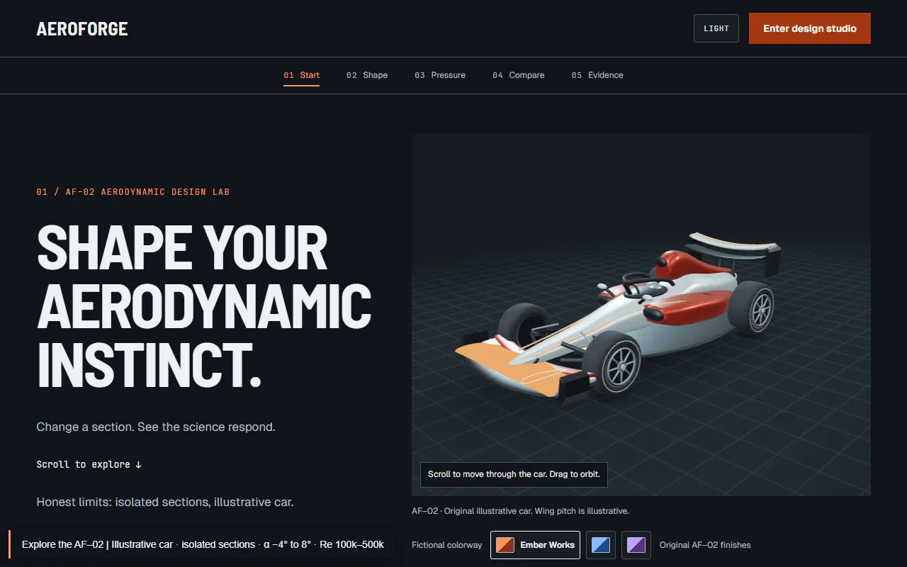
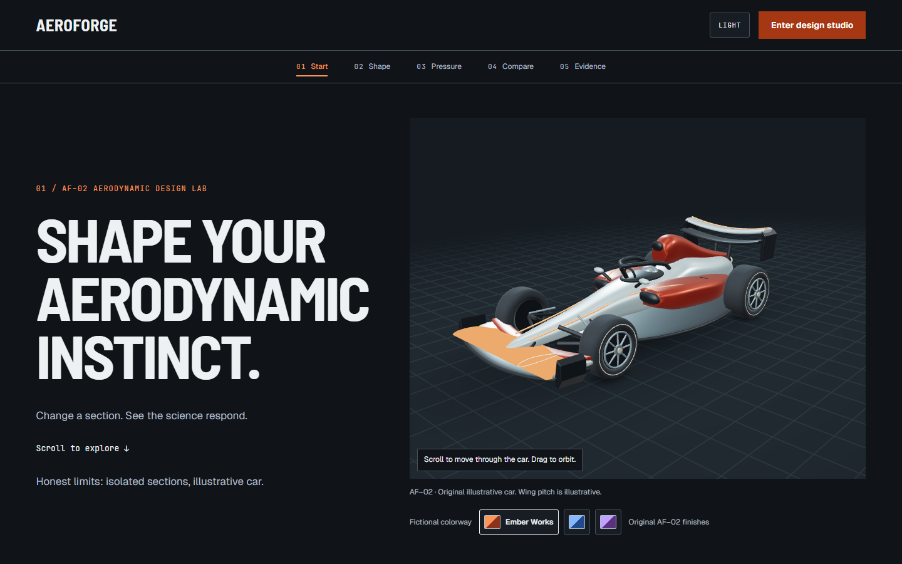
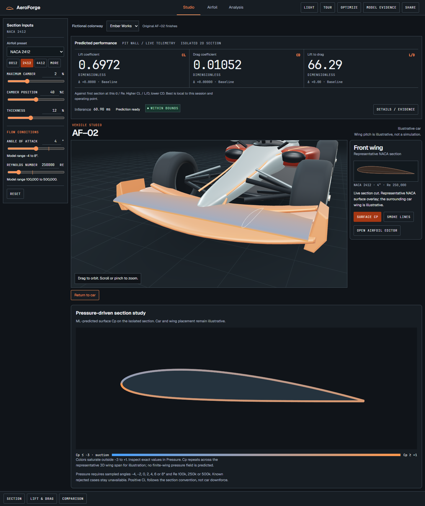
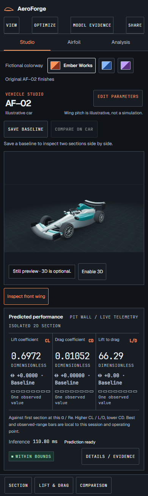
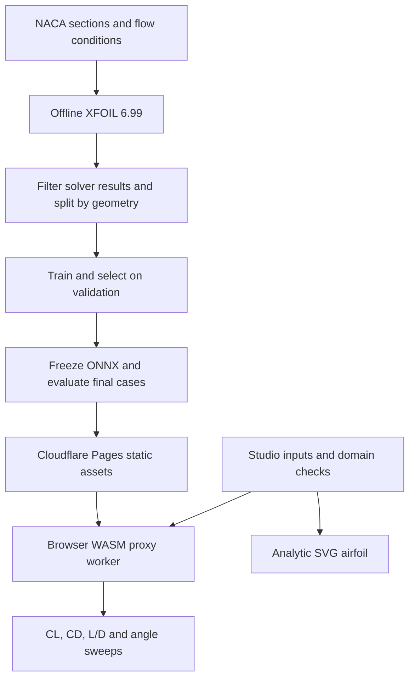

<h1 align="center">AeroForge</h1>

<p align="center">Edit an airfoil in your browser and see how its shape changes predicted lift and drag.</p>

<p align="center">
  <a href="LICENSE"></a>
  <a href="https://aeroforge-9tf.pages.dev/"></a>
  <a href="https://github.com/marbo786/AeroForge/actions/workflows/ci.yml"></a>
  
  
  
  
</p>

<p align="center">
  <a href="https://aeroforge-9tf.pages.dev/"><strong>Live Studio</strong></a> ·
  <a href="docs/CASE_STUDY.md">Case study</a> ·
  <a href="docs/ARCHITECTURE.md">Architecture</a> ·
  <a href="artifacts/recovery-v1-complete/final-evaluation.json">Model evidence</a>
</p>

<p align="center">
  <a href="https://aeroforge-9tf.pages.dev/"></a>
</p>

<table align="center">
  <tr>
    <td align="center"></td>
    <td align="center"></td>
    <td align="center"></td>
  </tr>
  <tr>
    <td align="center">AF-02 inspection bay</td>
    <td align="center">Front-wing section</td>
    <td align="center">Mobile Studio</td>
  </tr>
</table>

## What it is

AeroForge is a design studio for four-digit NACA airfoils. Save a baseline, change the camber, and compare the lift and drag of the two sections at the same angle of attack.
Two neural networks trained offline on viscous XFOIL 6.99 results predict the coefficients of an isolated section. ONNX Runtime Web runs both networks in the browser without an inference API.

## Honest limits

> [!IMPORTANT]
> The AF-02 car, its front-wing assembly and its pitch are illustrative. Predictions cover isolated 2D NACA sections within sampled geometry bounds, angles of attack from **−4° to 8°**, and **Reynolds numbers from 100,000 to 500,000**.
> Full-scale Formula 1 front-wing conditions lie outside this envelope. Reported errors measure agreement with XFOIL. Experimental validation, post-stall performance and calibrated uncertainty remain open.

## Features

| In the Studio | What you can do                                                                                                                                                                            |
| ------------- | ------------------------------------------------------------------------------------------------------------------------------------------------------------------------------------------ |
| Inspect       | Switch AF-02 liveries, select the front wing and inspect its section cut. View predicted surface pressure coefficient (Cp) at supported operating points or turn on schematic smoke paths. |
| Edit          | Drag the NACA geometry handles or edit camber, camber position and thickness. Adjust angle of attack and Reynolds number to see lift (CL), drag (CD) and lift-to-drag ratio (L/D).         |
| Compare       | Save a baseline and compare the two sections on the car or inspect their lift and drag curves in Analysis.                                                                                 |
| Optimize      | Search candidate sections, apply a result and share the completed search as a challenge card.                                                                                              |
| Share         | Copy a URL that restores the design and livery, or export a PNG design card.                                                                                                               |
| View          | Switch between light and dark themes. Phones start with a still preview and can enable 3D on demand.                                                                                       |

## Model accuracy

The dataset contains **1,046 eligible XFOIL cases across 52 geometries**. Model selection used validation data only. The model and preprocessing were frozen before XFOIL generated the final **165 cases from 8 unseen geometries**.

| Predicted coefficient | Mean absolute error (MAE) | Root mean squared error |      R² |
| --------------------- | ------------------------: | ----------------------: | ------: |
| Lift (CL)             |               **0.01484** |                 0.02553 | 0.99733 |
| Drag (CD)             |              **0.000683** |                0.001165 | 0.98260 |

All three models below were evaluated on the same final cases. Lower MAE means closer agreement with XFOIL.

| Model                     |      CL MAE |       CD MAE |
| ------------------------- | ----------: | -----------: |
| Original pilot MLP        |     0.04259 |     0.001821 |
| Matérn Gaussian process   |     0.01951 |     0.000896 |
| Selected independent MLPs | **0.01484** | **0.000683** |
| Acceptance maximum        |     0.05000 |     0.001500 |

Drag at low Reynolds numbers and highly cambered sections were harder to predict. [Frozen evaluation](artifacts/recovery-v1-complete/final-evaluation.json) · [Training and error analysis](docs/ML.md)

## How it works



- **Split by geometry.** All operating points for one airfoil stay in the same partition, so the final test measures generalization to new shapes.
- **Verify the model before loading it.** The browser checks the SHA-256 digest of the **49,781-byte** coefficient model. The ONNX graph includes the fitted input and output transforms.
- **Keep inference off the UI thread.** A proxy worker initializes the runtime and runs inference with one WebAssembly thread while the editor handles input.

[Browser architecture](docs/ARCHITECTURE.md) · [Solver data generation](docs/DATA.md) · [Geometry, units and conventions](docs/PHYSICS.md)

## Tech stack

| Layer                | Implementation                                                                            |
| -------------------- | ----------------------------------------------------------------------------------------- |
| Frontend             | Next.js 16.4.5, React 19.3.1, TypeScript 5.9.3, Tailwind CSS 4.3.5                        |
| 3D and animation     | Three.js 0.187.0, React Three Fiber 9.8.2, Motion 14.10.1, Lenis 1.3.27                   |
| ML runtime           | ONNX Runtime Web 1.31.1 with WebAssembly                                                  |
| Data and ML pipeline | XFOIL 6.99, pandas 2.3.3, PyArrow 22.0.0, scikit-learn 1.7.2, PyTorch 2.12.0, ONNX 1.19.1 |
| Testing and CI       | Node.js test runner, Playwright 1.65.0, pytest 9.0.2, GitHub Actions                      |
| Hosting              | Next.js static export on Cloudflare Pages                                                 |

## Quick start

### Run the Studio

Use **Node.js 24.11.0** and **npm 11.6.1**. From the repository root, run the following commands.

```sh
cd web
npm ci
npm run build
npm run serve
```

Open `localhost:4173` and choose **Enter design studio**. [Deployment guide](docs/DEPLOYMENT.md)

### Audit the Python evidence

From the repository root, use a Python 3.11 environment and install the pinned dependencies. Install PyTorch from its CPU wheel index first, as CI does.

```sh
python -m pip install torch==2.12.0 --index-url https://download.pytorch.org/whl/cpu
python -m pip install -r requirements-test.txt -r requirements-data.txt -r requirements-ml.txt
python -m pytest -q
```

The audit uses the saved evidence and runs without the XFOIL executable.

## Project structure

```text
web/               Studio, browser inference, static export and browser tests
python/aeroforge/  NACA geometry, solver integration and model training
scripts/           Data generation, model selection and evaluation commands
artifacts/         Exported models, frozen metrics and model evidence
data/              Solver runs, accepted operating points and provenance
configs/           Solver settings, training configurations and split plans
shared/            Geometry and optimizer contracts
tests/             Python tests and reference geometry fixtures
docs/              Architecture, methods, case study and deployment guides
```

## Verification

- `npm run verify` from `web/` checks formatting, lint, types, Node tests, the production build, Pages export and Playwright workflows. Playwright uses installed Chrome on Windows. On Linux, CI provisions Chromium with `npx playwright install --with-deps chromium`.
- `python -m pytest -q` from the root checks geometry, solver handling, model evidence, pressure, reliability and optimizer behavior.

[CI runs and test results](https://github.com/marbo786/AeroForge/actions/workflows/ci.yml) · [Release checklist](docs/RELEASE_CHECKLIST.md)

## Roadmap

- Define and validate a solver and dataset for a main plane and flap before extending the editor. [Multi-element wing plan](docs/MULTI_ELEMENT_WING.md)
- Compare predictions with independent experimental measurements.
- Evaluate post-stall behavior before extending the angle-of-attack range.
- Calibrate prediction uncertainty across the supported operating envelope.

## License and acknowledgements

The [MIT license](LICENSE) covers AeroForge’s original code and documentation. XFOIL runs offline under its upstream GPL license. The distribution excludes its executable.

The browser export includes the upstream notices for its fonts, ONNX runtime and other third-party components.
