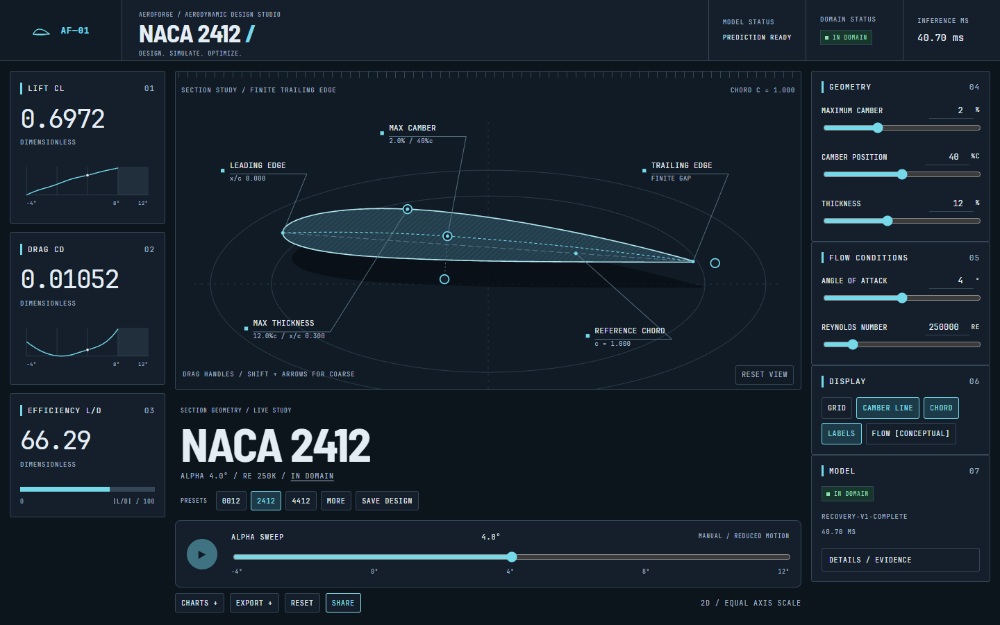

# AeroForge

AeroForge is an interactive airfoil design studio. Edit a NACA four-digit section, predict lift and drag in the browser, and compare the result against a saved design. It runs as a static site with a local ONNX model.

[Open the live studio](https://aeroforge-9tf.pages.dev/) · [Engineering case study and architecture diagram](docs/CASE_STUDY.md) · [Launch checklist](docs/RELEASE_CHECKLIST.md)



[Before and after at four screen sizes](docs/ui-launch/README.md) · [Mobile charts](docs/ui-launch/after/390x844-charts.png)

## Run locally

Use Node.js 24.11.0 and npm 11.6.1.

```sh
cd web
npm ci
npm run build
npm run serve
```

Open [the local studio](http://127.0.0.1:4173/). Drag a geometry handle or use the parameter controls. Focus a handle and press an arrow key to adjust it, or hold Shift for coarse steps. Use **Charts** to inspect lift and drag across angle of attack. **Save design** captures one comparison candidate, and **Share** copies a URL that restores the current geometry and operating conditions. Mobile controls open through **Edit parameters**. **Details / evidence** opens the model limits and links to the final evaluation.

Run `npm run verify` from `web` for lint, TypeScript, Node tests, static export checks and end-to-end tests against production files. Playwright uses installed Chrome on Windows and its matching Chromium on Linux. The separate `/spike/` route is an inference test fixture.

## Model and evidence

The model uses two independently fitted neural networks for lift and drag. Training used eligible viscous XFOIL 6.99 runs. The recovery dataset contains 1,046 eligible cases across 52 geometries, including 165 final-test cases from eight unseen geometries. The 49,781-byte ONNX graph embeds the fitted transforms and accepts `[m, canonical_p, t, alpha_deg, log10(Re)]`.

| Frozen final test | MAE | Acceptance limit (MAE) | RMSE | R² |
| --- | ---: | ---: | ---: | ---: |
| Lift coefficient (CL) | **0.01484** | 0.05000 | 0.02553 | 0.99733 |
| Drag coefficient (CD) | **0.000683** | 0.001500 | 0.001165 | 0.98260 |

Predictions are available from **−4° to 8°** and **Re 100,000 to 500,000** within the geometry envelope. The evidence comes from a finite solver panel. Intermediate Reynolds values are interpolations, and low-Re drag and high-camber cases are harder to predict. Experimental accuracy, post-stall behavior and calibrated uncertainty remain unverified.

See [model training, evaluation and reproduction](docs/ML.md), [XFOIL data generation](docs/DATA.md), [the recovery dataset](data/recovery-v1/README.md), and [the geometry and units contract](docs/PHYSICS.md). To rerun the Python evidence audit, install the pinned requirements documented there, then run `python -m pytest -q` from the repository root. Existing evidence can be audited without running XFOIL.

To reproduce training, create a fresh recovery plan with `scripts/plan_recovery.py`, generate the development labels with the documented `scripts/run_pilot.py` configurations, then run `scripts/tune_recovery.py`. Follow the freeze, simulation and evaluation steps in the [recovery protocol](docs/ML.md) with new output paths and an independent final reservation.

## Hosting and license

The existing v1 release is live on [Cloudflare Pages](https://aeroforge-9tf.pages.dev/). The dark studio pictured above is the separately tested launch candidate. To deploy it, use `web` as the Pages build root, run `npm run build`, and publish `out`. See the [deployment and verification guide](docs/DEPLOYMENT.md) for pinned tool versions, cache headers, and the public smoke check. No inference API or paid infrastructure is required for the static design.

The [engineering case study](docs/CASE_STUDY.md#limits-and-roadmap) describes future validation work. See the [progress record](PROGRESS.md) for completed milestones.

Original application code and documentation use the [MIT License](LICENSE). The browser export includes third-party notices for the runtime, framework, animation packages and fonts. XFOIL uses its upstream license and runs offline. The binary is excluded from this distribution.
