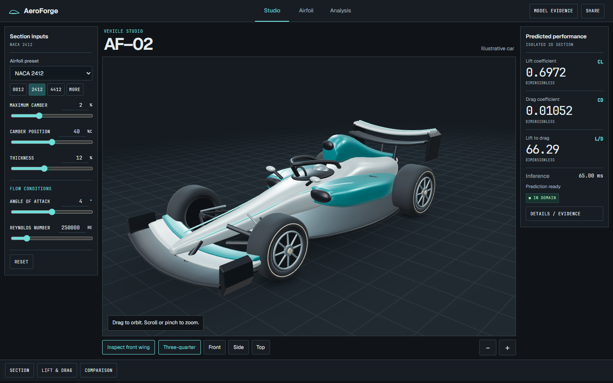

# AeroForge

AeroForge pairs an interactive 3D inspection bay for the illustrative AF–02 car with a NACA four-digit airfoil editor and browser-based ONNX predictions for an isolated 2D section.

[Open the live studio](https://aeroforge-9tf.pages.dev/) · [Architecture](docs/ARCHITECTURE.md) · [Release checklist](docs/RELEASE_CHECKLIST.md)



[Visual review at four screen sizes](docs/v2-5/README.md) · [Mobile Analysis](docs/v2-5/after/390-analysis.png)

## Run locally

Use Node.js 24.11.0 and npm 11.6.1.

```sh
cd web
npm ci
npm run build
npm run serve
```

Open Studio to orbit the car and select **Inspect front wing**. Use Airfoil to edit the representative NACA section with sliders or geometry handles, and use Analysis to inspect lift and drag curves and compare a saved design. **Share** copies a URL that restores the current view and design. Phones start with a still preview and offer **Enable 3D** and **Edit parameters**. **Details / evidence** opens the model limits and links to the final evaluation. [Local Studio](http://127.0.0.1:4173/)

Run `npm run verify` from `web` for lint, strict TypeScript, the static export checks, 23 Node tests and 59 Playwright tests. The separate Python evidence suite has 104 tests. V2.5 Lighthouse lab performance was 92 on mobile and 86 on desktop, with 100 for accessibility, best practices and SEO in both profiles. Playwright uses installed Chrome on Windows and its matching Chromium on Linux. The separate `/spike/` route is an inference test fixture. [V2.5 measurements](docs/v2-5/README.md)

## Model and evidence

The model uses two independently fitted neural networks for lift and drag. Training used eligible viscous XFOIL 6.99 runs. The recovery dataset contains 1,046 eligible cases across 52 geometries, including 165 final-test cases from eight unseen geometries. The 49,781-byte ONNX graph embeds the fitted transforms and accepts `[m, canonical_p, t, alpha_deg, log10(Re)]`.

| Frozen final test | MAE | Acceptance limit (MAE) | RMSE | R² |
| --- | ---: | ---: | ---: | ---: |
| Lift coefficient (CL) | **0.01484** | 0.05000 | 0.02553 | 0.99733 |
| Drag coefficient (CD) | **0.000683** | 0.001500 | 0.001165 | 0.98260 |

Predictions are available from **−4° to 8°** and **Re 100,000 to 500,000** within the geometry envelope. The evidence comes from a finite solver panel. Intermediate Reynolds values are interpolations, and low-Re drag and high-camber cases are harder to predict. Experimental accuracy, post-stall behavior and calibrated uncertainty remain unverified.

See [model training, evaluation and reproduction](docs/ML.md), [XFOIL data generation](docs/DATA.md), [the recovery dataset](data/recovery-v1/README.md), and [the geometry and units contract](docs/PHYSICS.md). To rerun the Python evidence audit, install the pinned requirements documented there, then run `python -m pytest -q` from the repository root. Existing evidence can be audited without running XFOIL.

To reproduce training, create a fresh recovery plan with `scripts/plan_recovery.py`, generate the development labels with the documented `scripts/run_pilot.py` configurations, then run `scripts/tune_recovery.py`. Follow the freeze, simulation and evaluation steps in the [recovery protocol](docs/ML.md) with new output paths and an independent final reservation.

## Hosting and license

The v2 Studio is live on Cloudflare Pages. On 2026-11-16 the public smoke test passed and the served vehicle assets matched GitHub `main` at merge `075bf74` (PR #1). V2.6 remains pending for deployment metadata and the separate preview and rollback checks. The static export runs browser inference without an inference API. [Live Studio](https://aeroforge-9tf.pages.dev/) · [Release checklist](docs/RELEASE_CHECKLIST.md) · [Deployment guide](docs/DEPLOYMENT.md)

The [engineering case study](docs/CASE_STUDY.md#limits-and-roadmap) describes future validation work. See the [progress record](PROGRESS.md) for completed milestones.

Original application code and documentation use the [MIT License](LICENSE). The browser export includes third-party notices for the runtime, framework, animation packages and fonts. XFOIL uses its upstream license and runs offline. The binary is excluded from this distribution.
