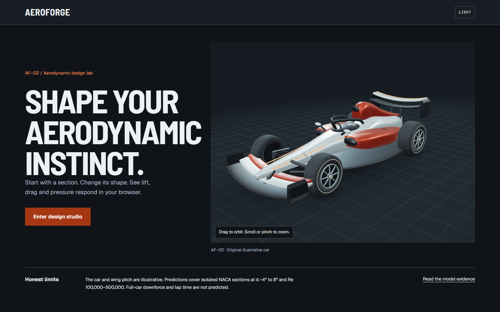

# AeroForge

AeroForge is an airfoil design studio with a 3D inspection bay for the illustrative AF–02 car, an interactive NACA editor, and live ONNX predictions for an isolated 2D section.

[Open the live studio](https://aeroforge-9tf.pages.dev/) · [Architecture](docs/ARCHITECTURE.md) · [Release checklist](docs/RELEASE_CHECKLIST.md)

## Honest limits

The car and wing pitch are illustrative. Predictions describe isolated NACA sections within **−4° to 8°** and **Re 100,000 to 500,000**, below typical full-scale Formula 1 front-wing conditions. [Formula 1 front-wing study](https://link.springer.com/article/10.1007/s00348-026-04191-5)



[Interaction demo](docs/media/aeroforge-demo.gif) · [Studio](docs/polish/phase-5/1440-dark-studio.png) · [Mobile Analysis](docs/polish/phase-5/390-dark-analysis.png)

## Model accuracy

The frozen final test measures agreement with XFOIL on 165 eligible cases from eight unseen geometries. [Frozen evaluation](artifacts/recovery-v1-complete/final-evaluation.json)

| Coefficient | MAE | MAE target | RMSE | R² |
| --- | ---: | ---: | ---: | ---: |
| Lift (CL) | **0.01484** | 0.05000 | 0.02553 | 0.99733 |
| Drag (CD) | **0.000683** | 0.001500 | 0.001165 | 0.98260 |

## Run locally

Use Node.js 24.11.0 and npm 11.6.1.

```sh
cd web
npm ci
npm run build
npm run serve
```

Start with the AF–02 landing scene and choose **Enter design studio** for a short, skippable tour. Studio, Airfoil and Analysis share the same section and live coefficients. Phones start with a still preview and offer **Enable 3D** and **Edit parameters**.

Choose an original fictional colorway, toggle the remembered light theme, and use **Inspect front wing** to see the live representative NACA surface and section cut. **Surface Cp** uses the existing pressure model at sampled operating points; smoke paths are explicitly schematic. Save a baseline and choose **Compare on car** for side-by-side inspection, or compare section curves in Analysis. **Share** provides a restorable design/colorway URL and a designed PNG card. Completed optimizer searches include a shareable challenge card; track briefs remain illustrative. **Details / evidence** explains model applicability. [Local Studio](http://127.0.0.1:4173/) · [Portfolio polish and screenshots](docs/polish/README.md)


Run `npm run verify` from `web` for formatting, lint, strict TypeScript, static export checks, 29 Node tests and 109 executed Playwright tests (18 viewport-specific skips). These presentation changes leave Python code and all frozen coefficient/pressure artifacts untouched; the Python evidence audit remains a separate check. Historical V2.5 Lighthouse lab performance was 92 on mobile and 86 on desktop, with 100 for accessibility, best practices and SEO in both profiles. Playwright uses installed Chrome on Windows and matching Chromium on Linux. The separate `/spike/` route is an inference fixture. [V2.5 measurements](docs/v2-5/README.md) · [Current local verification](docs/polish/README.md)


## Model and evidence

The model uses two independently fitted neural networks for lift and drag. The recovery dataset contains 1,046 eligible cases across 52 geometries from viscous XFOIL 6.99 runs. The 49,781-byte ONNX graph embeds the fitted transforms and accepts `[m, canonical_p, t, alpha_deg, log10(Re)]`.

Prediction bounds also depend on the section geometry. Intermediate Reynolds values are interpolations, and low-Re drag and high-camber cases are harder to predict. Experimental accuracy, post-stall behavior and calibrated uncertainty remain unverified.

See [model training, evaluation and reproduction](docs/ML.md), [XFOIL data generation](docs/DATA.md), [the recovery dataset](data/recovery-v1/README.md), and [the geometry and units contract](docs/PHYSICS.md). To rerun the Python evidence audit, install the pinned requirements documented there, then run `python -m pytest -q` from the repository root. Existing evidence can be audited without running XFOIL.

To reproduce training, create a fresh recovery plan with `scripts/plan_recovery.py`, generate the development labels with the documented `scripts/run_pilot.py` configurations, then run `scripts/tune_recovery.py`. Follow the freeze, simulation and evaluation steps in the [recovery protocol](docs/ML.md) with new output paths and an independent final reservation.

## Hosting and license

The portfolio-polish updates are published on Cloudflare Pages. [Release record and rollback target](docs/PORTFOLIO_RELEASE.md).

The v2 Studio is live on Cloudflare Pages. On 2026-11-16 the public smoke test passed and the served vehicle assets matched GitHub `main` at merge `075bf74` (PR #1). V2.6 remains pending for deployment metadata and the separate preview and rollback checks. The static export runs browser inference without an inference API. [Live Studio](https://aeroforge-9tf.pages.dev/) · [Release checklist](docs/RELEASE_CHECKLIST.md) · [Deployment guide](docs/DEPLOYMENT.md)

The plan-only [multi-element wing design note](docs/MULTI_ELEMENT_WING.md) outlines future data and validation needs. The [engineering case study](docs/CASE_STUDY.md#limits-and-roadmap) describes future validation work. See the [progress record](PROGRESS.md) for completed milestones.

Original application code and documentation use the [MIT License](LICENSE). The browser export includes third-party notices for the runtime, framework, animation packages and fonts. XFOIL uses its upstream license and runs offline. The binary is excluded from this distribution.
