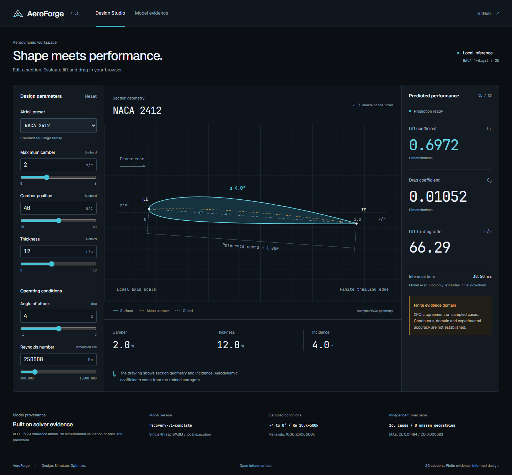
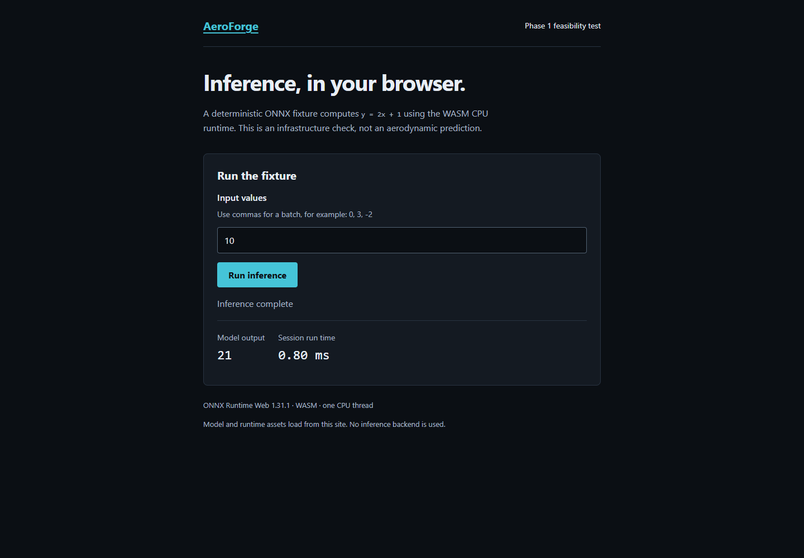

# AeroForge

Design. Simulate. Optimize.

AeroForge is a phased aerodynamic design studio project. **Phases 1–5 are implemented:** static browser inference, tested NACA geometry, traceable XFOIL data, an independently evaluated surrogate and a responsive Design Studio with real lift/drag telemetry.

Read [the full specification](docs/SPEC.md) and [the progress tracker](PROGRESS.md) before development. Each subsequent phase requires approval.

Phase 4 recovery **passed**: the validation-selected independent lift/drag MLP achieved fresh final-test CL/CD MAEs of **0.01484 / 0.000683**, meeting unchanged 0.05 / 0.0015 targets. The eight final geometries were simulated only after selection/export freeze. The 49,781-byte model powers the studio through browser WASM with numerical agreement below 1e-5. See [the full experiment and limitations report](docs/ML.md); the original failed pilot metrics and artifacts are preserved there.

The ML audit tests require `requirements-ml.txt` in addition to the data/test requirements. The local run uses `.venv-ml\Scripts\python.exe -m pytest -q`; it reuses the working CPU PyTorch installation and keeps export packages project-local. See [Phase 5 validation and screenshots](docs/phase-5/README.md) and the progress tracker for current checks.

The selected model takes five float32 features `[m, canonical_p, t, alpha_deg, log10(Re)]` and returns `[CL, CD]`, with feature construction/scaling/inversion embedded. Its evidence covers a finite non-stall panel at Re 100,000 / 250,000 / 500,000. It does not establish experimental accuracy, post-stall validity, continuous-domain certainty or Re 1,000,000 support. The [recovery data](data/recovery-v1/README.md) retain all failures and the consumed original test remains diagnostic-only.

## Real solver pilot

The [committed pilot](data/pilot-v1/README.md) contains 280 attempted XFOIL 6.99 viscous cases across 20 geometries, two Reynolds numbers and seven angles. It produced 227 eligible CL/CD labels; all nonconverged and suspect results remain traceable and excluded. Logs, polars, panel geometries, input streams, configuration and hashes are retained. Three repeat runs matched at saved polar precision.

Read [data-generation documentation](docs/DATA.md) for solver acquisition, exact configuration, acceptance results and limitations. The sparse pilot establishes the pipeline; it is not an experimental validation or a trained-model accuracy claim. No NeuralFoil fallback was used.

The full Python audit suite also requires the pinned `requirements-data.txt` dependencies. CI verifies committed raw evidence without executing or downloading XFOIL. To reproduce the pilot on an approved Windows setup, run `python scripts/run_pilot.py --output data/pilot-reproduction` with the pinned local solver available.

## Geometry engine

The Python and browser-compatible TypeScript libraries implement camber, slope, normal thickness offsets, cosine sampling and ordered contours. They share bounds, coefficients and ten presets. Symmetric airfoils canonicalize `p=0`; lossless geometry IDs agree across languages. No UI integration or solver is included in Phase 2.

See [the physics contract](docs/PHYSICS.md) for equations, units, finite trailing-edge convention, APIs and limitations. From the repository root, with pytest 9.0.2 installed in your Python environment:

```sh
python -m pytest -q
```

For a new test environment, use a virtual environment and install `requirements-test.txt`. Geometry itself has no Python runtime dependencies. The Python suite also requires Node 24.11.0 to execute its cross-language parity check.

Phase 2 validation passed: 62 Python tests (including complete Python/TypeScript geometry parity across 28 cases), 21 Node tests (19 geometry and 2 asset tests), TypeScript, a production static build and all 10 browser smoke tests. Analytic station fixtures use an independent 60-digit Decimal oracle; they are not solver or experimental aerodynamic data.

## Run the Design Studio

Use Node.js 24.11.0 and npm 11.6.1:

```sh
cd web
npm ci
npm run verify
```

On Windows, Playwright uses installed Chrome without a browser download. On Linux, install its matching Chromium before smoke tests (`npx playwright install --with-deps chromium`). The latter may install system dependencies and requires appropriate authorization locally; CI runs in an isolated runner.

`npm run verify` prepares assets, checks TypeScript, tests the model and runtime artifacts, builds a static production export, and runs browser smoke tests against that export. No Next.js development or production server is used by the smoke tests. For manual inspection:

```sh
npm run serve
```

Open `http://127.0.0.1:4173/` or `/studio/`. Select a NACA preset or edit geometry and operating conditions; lift, drag, L/D and execution time come from the real model. Mobile controls expand through **Edit parameters**. Bounds and limitations remain visible; extrapolated predictions are withheld. `npm run dev` is available for development but is not acceptance evidence.

The separate `/spike/` route retains the original infrastructure fixture: input `0, 3, -2, 0.25` produces `1, 7, -3, 1.5`.



[Mobile Design Studio](docs/phase-5/mobile.png)

## What is being tested

- Next.js static export, including direct access to the nested `/spike/` route.
- Actual float32 ONNX `Mul` and `Add` execution (`y = 2x + 1`), with dynamic batches.
- Lazy ONNX Runtime Web CPU/WASM loading from the same origin as the page.
- Correct same-build WASM/module companion assets, one-thread execution without cross-origin isolation, and versioned caching.
- Invalid input, missing model, missing WASM, model-load retry, repeated inference and warm reload behavior.
- Desktop (1440px) and mobile (390px) production smoke tests and screenshots.

Phase 1 validation passed: strict TypeScript, 2 asset tests, and 10 production browser smoke tests on Windows Chrome 156.0.8078.81. The same-origin dedicated module-worker experiment also passes. Recorded network evidence is in [docs/phase-1](docs/phase-1/); CI and public hosting have not been run remotely.



[Mobile screenshot](docs/phase-1/mobile.png)

The fixture is reproducibly generated with `onnx-proto`, ONNX IR 8 and opset 13. Its manifest includes its hash and purpose. Generated model/runtime assets are ignored by Git and regenerated on each build. See [deployment instructions](docs/DEPLOYMENT.md) and [Phase 1 architecture](docs/ARCHITECTURE.md).

## Boundaries and roadmap

There is no inference backend, database, account system, paid service, or third-party core-runtime request. The static verification server is a local development tool, not a production dependency. Deployment to a public host has not been performed.

Next phases cover real charts, comparison and URL sharing, followed by public-release verification. XFOIL 6.99 and browser model inference work in the verified setup. Experimental physical validation, calibrated uncertainty and broader supported-domain evidence are not claimed.
