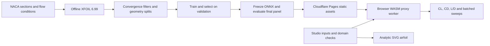

# AeroForge engineering case study

An airfoil designer needs to see how geometry and flow conditions change lift and drag while exploring a design. Running a viscous solver for every edit would tie the interaction to solver execution and convergence. AeroForge trains a small surrogate offline, then uses it to predict section coefficients in the browser as the user edits the airfoil.

## Build the reference dataset

The Python pipeline generates NACA four-digit sections with cosine station spacing and a finite trailing edge. It runs XFOIL 6.99 in viscous mode and keeps each input, solver log, convergence decision, and accepted polar together. The accepted recovery dataset contains 1,046 rows across 52 geometries. It reserves 657 training rows and 163 validation rows, 61 rows for diagnostics on the consumed pilot test, and 165 final rows from eight unseen geometries. Splits are disjoint by canonical geometry. The pipeline excludes nonconverged and suspect results and preserves their evidence. [Simulation methodology](DATA.md) · [Dataset provenance](../data/recovery-v1/README.md)

## Select and evaluate a surrogate

The validation sweep compared 19 recovery candidates, including Ridge, random forest, Gaussian process and neural models. Selection used validation only. The winner has two independent SiLU networks, with a learnable lift residual relative to a thin-airfoil prior and a positive drag output restored from log space. The model and preprocessing were frozen before generating the independent test panel.

| Model on the same 165 final cases | CL MAE | CD MAE |
| --- | ---: | ---: |
| Original pilot MLP | 0.04259 | 0.001821 |
| Recovery Matérn GP | 0.01951 | 0.000896 |
| Selected independent MLP | **0.01484** | **0.000683** |
| Acceptance maximum | 0.05000 | 0.001500 |

The selected model achieved CL/CD RMSE of 0.02553/0.001165 and R² of 0.99733/0.98260. These numbers measure agreement with eligible XFOIL cases. [Frozen final evaluation](../artifacts/recovery-v1-complete/final-evaluation.json) · [Selection and experiment details](ML.md)

## Run the model in the browser

The ONNX graph takes five float32 features and embeds the derived features, scaling and inverse target transforms. The browser checks the graph's SHA-256 before loading it in ONNX Runtime. The model is 49,781 bytes. One WASM thread runs in the proxy worker, which lets the editor stay responsive during initialization. The Next.js static export serves the code, graph and matching runtime from the same origin. [Browser architecture](ARCHITECTURE.md) · [Static deployment](DEPLOYMENT.md)

## Limits and roadmap

The prediction envelope is −4° to 8° and Reynolds number 100,000 to 500,000 within the sampled geometry bounds. Intermediate Reynolds values are interpolations. Low-Re drag and high-camber sections were harder on the final panel. XFOIL convergence filtering introduces selection bias. Experimental validation, calibrated uncertainty and post-stall behavior remain open. Future work can extend the independent evaluation and quantify uncertainty before broadening the operating envelope. [Scientific limitations](ML.md#export-production-verification-and-limits)
