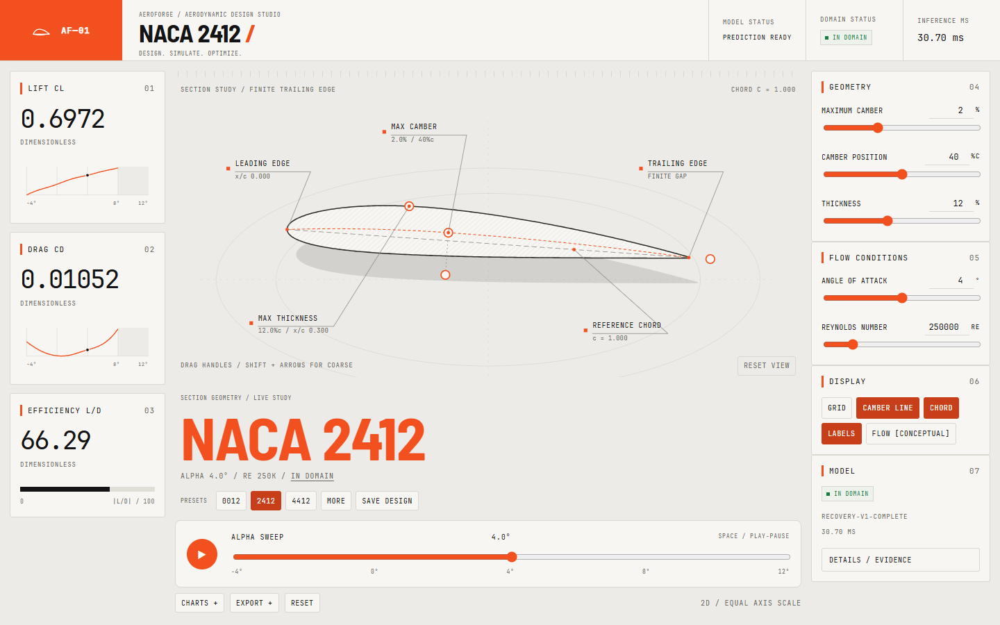

# Instrument UI review

The user's attached redesign request and later reference image explicitly replaced the earlier dark styling with paper, ink and vermilion and authorized the listed presentation interactions. This is a UI-only extension of the committed Phase 5 baseline (`4ea242f`), not a new model or optimizer phase. The shared token/component kit was committed first as `57ec4a1`, followed by the tested workstation implementation in `398baa8`.

## Presentation and interaction

The desktop composition uses a vermilion logo tile, condensed display headings, mono instrumentation, numbered side modules and a large equal-axis NACA section. Live leader callouts identify the leading/trailing edges, maximum camber/thickness and reference chord. A displaced plane supplies visual depth without distorting the actual section. All fonts are self-hosted.

Camber, position, thickness and rotation handles support pointer/touch dragging and keyboard arrows (Shift for coarse changes). Parameters, not SVG paths, drive Motion interpolation. Wheel, pinch and drag support view zoom/pan; Reset view restores it. The alpha dock spans -4 to 12 degrees, supports playback/Space and withholds unsupported predictions above 8 degrees. Reduced motion disables autoplay, parameter morphing and numeric springs, including when the preference changes after loading.

The original validated controller and 80 ms inference debounce remain intact. Drag events coalesce on animation frames with a 110 ms minimum interval, enabling predictions between sustained drag updates. Pending values are dimmed and labeled previous/loading, never current. Real-model sweeps provide sparklines, CL/alpha, CD/alpha, drag polar and L/D/alpha. The saved comparison is session-local and uses another real sweep. SVG/PNG export the drawing; CSV contains the 25 supported sweep samples; JSON includes current coefficients or null when unavailable.

At tablet width the hero spans the top above two module columns. Mobile has a prominent stage, sticky telemetry strip, compact presets and a peek/half/full control sheet with its scrubber dock above it. Details and Charts are native modal dialogs with keyboard dismissal and focus restoration. The `/model/` route uses the same typography, numbered modules and actual frozen evaluation metrics.

## Visual QA: inspect, refine, repeat

All three review rounds used production output and Windows installed Chrome, at 1440×900, 1024×768 and 390×844. Images were opened for visual inspection, rather than only generated. Full-page tablet/mobile evidence is intentionally taller than its viewport. Reproduce with `cd web` then `node scripts/capture-ui.mjs final-review` after building.

First pass (`pass-1/`), five largest gaps:

1. The central section was too small relative to its stage: tightened the SVG view box while retaining equal axes.
2. Callout and module microtype was too small: enlarged the typography and leader labels.
3. Mobile presets accidentally stretched to full-width rows: narrowed the selector to the label and restored compact chips.
4. Mobile geometry/state consumed the telemetry space: adjusted vertical proportions and placed presets above the strip.
5. White text on the bright active fill lacked contrast: introduced a deeper vermilion control token while retaining the specified accent for large marks and graphics.

Second pass (`pass-2/`), five further gaps and interaction findings:

1. The mobile dock obscured presets: tightened the hero/state spacing and reserved dock clearance.
2. Dock actions wrapped awkwardly: gave actions stable widths and removed the nonessential mobile scale caption.
3. The camber-position handle appeared detached: added a dashed stem to its actual chord station.
4. Callout lines intercepted direct manipulation: removed their pointer interception; drag tests now change actual coefficients.
5. Reduced-motion changes did not immediately stop springs/autoplay: subscribed directly to the media query and verified live preference changes.

Final refinement (`final-review/`): corrected queued input callbacks that could revert a newer scrubber value, limited the full sheet so the dock stays onscreen, restored the mobile evidence return link/logo, and made mobile snap controls at least 44×44 px. Final default, expanded-sheet, Details, Charts and evidence captures are retained. All three final JSON reports show no horizontal overflow and no browser console/page errors.

## Verification and boundaries

`npm run verify` passed asset integrity checks, lint, strict TypeScript, all 23 Node tests, a static production build and all 38 production Playwright tests (1.6 minutes). The browser suite covers frozen numeric vectors, exact target contour, valid/symmetric/invalid input, domain withholding, rapid updates, runtime errors/retry/hash corruption, direct manipulation, scrubber, sheets, reduced motion, dialogs, saved comparison, all export formats and evidence navigation. The original infrastructure tests remain enabled at desktop/mobile sizes.

`node scripts/profile-ui.mjs` recorded 179 requestAnimationFrame intervals during an actual pointer drag on the local production desktop UI: median 16.7 ms, p95 16.8 ms, mean 16.67 ms, zero intervals above 25 ms. See `frame-profile.json`. This supports smooth rendering on this machine; automation overhead is included and no universal hardware guarantee follows.

The Phase 5 Python audit previously passed 104 tests. There are no redesign changes under Python, shared geometry, accepted artifacts, preprocessing or `web/lib/inference/`. The accepted ONNX remains 49,781 bytes with SHA-256 `b30fa4b09cbaa62c8616d28dd10fedbdf1029337c1fe4eba0f0fdd1448a46ba8`. `docs/SPEC.md` remains byte-identical. Training, evaluation reservations and source evidence were not touched.

Still limited: mobile screenshots are touch/viewport emulation on this Windows Chrome machine; physical phone performance and broad-browser support are unverified. No universal 60 fps guarantee is established by screenshots. The drawing is intentionally a precise 2D section with a decorative offset plane; conceptual flow marks are explicitly labeled, not simulated streamlines. Saved designs do not persist across reloads. No deployment, remote push, URL sharing or optimizer work was performed.

[Tablet](final-review/tablet.png) · [Mobile](final-review/mobile.png) · [Expanded sheet](final-review/mobile-sheet.png) · [Charts](final-review/desktop-charts.png) · [Evidence](final-review/mobile-evidence.png)
